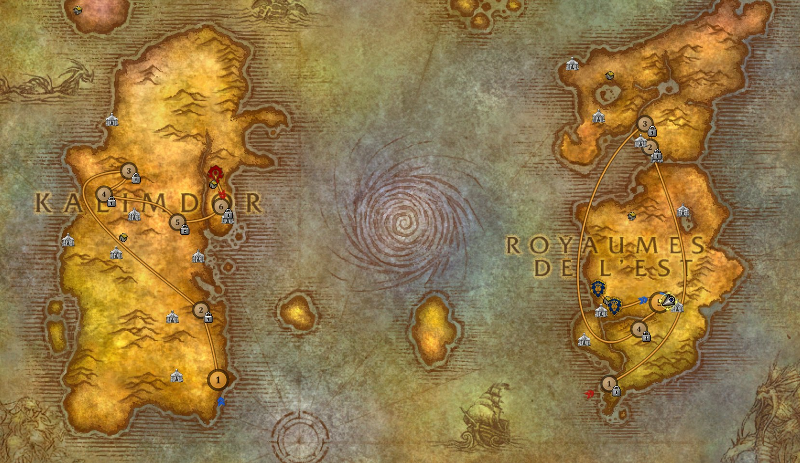
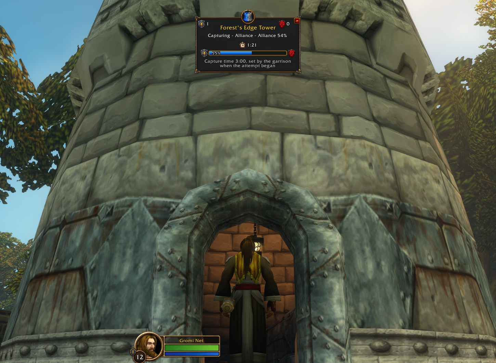
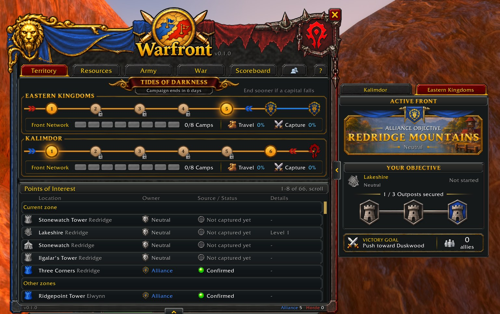
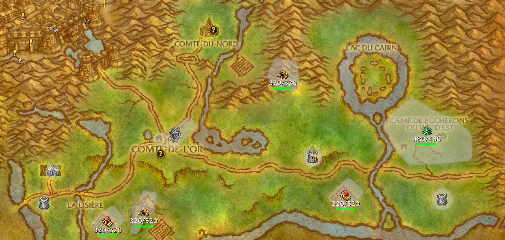
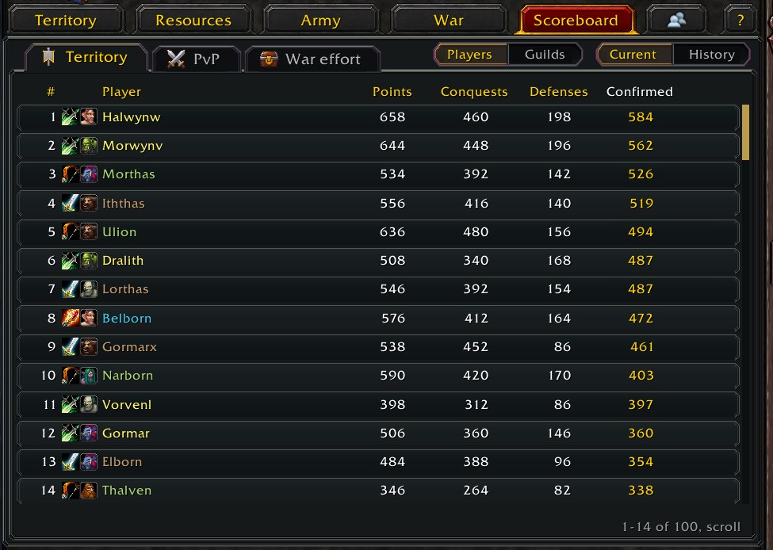

# Warfront

**Alliance vs Horde. Every zone is up for grabs.**

Warfront turns **World of Warcraft: Forever** into a real faction war. Capture outposts and settlements across Eastern Kingdoms and Kalimdor, raise armies, besiege the enemy and march on their capital. Every capture counts for your whole faction, and the map keeps the score.

**[Download the latest release](https://github.com/Tom75VN/Warfront/releases/latest)**, then type `/wf` in game.

## What you do

- **Conquer**: stand in an Outpost or Settlement to take it. Take every Outpost around a Settlement to start a 3-hour siege.
- **Push the front**: each continent has a campaign route. Win it Settlement by Settlement until the enemy capital is under siege.
- **Build your army**: gather gold, wood and food from mines, farms, forests and your professions, then recruit units, defend your places and send scouts and armies.
- **Climb the rankings**: Territory, PvP and War effort scoreboards for players and guilds.
- **Win the campaign**: up to 14 days, or over at once when a capital falls.

## Why you'll love it

- Your normal play feeds the war: gathering, professions and PvP all count.
- Built into your world map and minimap, with alerts when the front moves.
- English, French, Spanish, Russian and Simplified Chinese.

## Installation

1. Download `Warfront-<version>.zip` from the [latest release](https://github.com/Tom75VN/Warfront/releases/latest).
2. Extract it into `Interface\AddOns`, so that the addon ends up in `Interface\AddOns\Warfront`.
3. Start the game and open the main window with `/wf` or `/warfront`.

## Warfront Companion (optional)

Warfront works without anything else. The optional [Warfront Companion](https://github.com/Tom75VN/Warfront-Companion/releases/latest) for Windows and Mac adds complete scoreboards and keeps the map up to date between sessions.

## Status

Early release: Warfront is still being tested in the WoW: Forever client. The war grows with every player who joins: bring your guild.

## Licence

All rights reserved. See [LICENSE](LICENSE).
